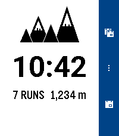
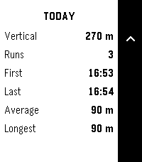
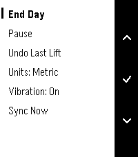
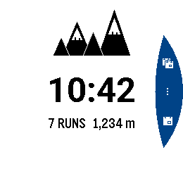
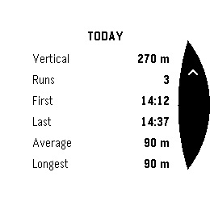
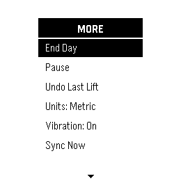
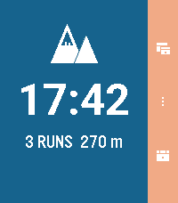
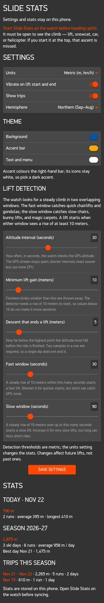
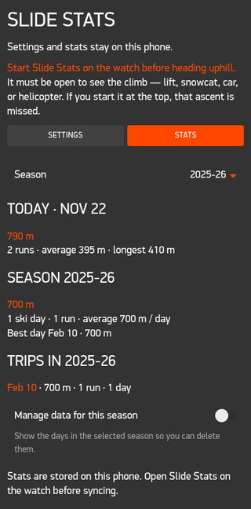
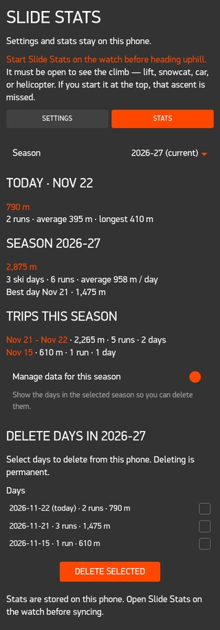

# Slide Stats

A Pebble watchapp that counts ski runs and vertical gained during a day on the mountain.

The watch face is deliberately plain: a large clock, the day's run and vertical totals,
and nothing else unless something needs attention. The phone watches altitude, recognises
ski-lift rides automatically, and stores each completed lift. The watch shows the phone's
latest summary and sends menu commands back; a native Clay configuration page on the phone
shows the settings and current-season statistics.

Built with [Alloy](https://developer.repebble.com/guides/alloy/), the Pebble JavaScript
framework, and drawn with Poco for a small memory footprint and infrequent redraws.

## Platform support

Alloy runs only on **Emery (Pebble Time 2)** and **Gabbro (Pebble Round 2)**. Those are
the only targets in `package.json`.

There is no barometer on either watch, so altitude comes from the phone's GPS. The phone
does the detection and owns the day; the watch app has to stay open while skiing, and the
phone has to stay connected with location permission granted.

## Status

A working first version:

- Automatic lift detection on the phone (fast and slow tiers, median-filtered altitude,
  descent-based ending)
- Auto-start on launch, undo last lift; exit the app to stop
- Time at the true vertical centre — centred in the content area on Emery and in the circle on Gabbro — with runs and vertical directly below
- Native action bar on the right: straight on Emery, curved on Gabbro, with
  destination icons for Up/Select/Down
- Phone-pushed Today and Season summaries: Up/Down walk older and newer days or seasons,
  while the watch caches the latest state
- Icon-only status: a disconnected watch when the phone link drops, a crossed circle when
  GPS/altitude is missing, and only when an indicator is needed
- Native Pebble ActionMenu for More, with Units, Vibration, and Undo Last Lift at the
  bottom; the left crumb column follows the theme accent and the body uses the system
  black/white style
- Four-peak main-face mark: two snow-capped back peaks and two smaller front peaks, with
  white separator lines; the launcher/store badge keeps the two-peak icon
- North/South seasons, re-bucketed automatically if the setting changes
- Phone-authoritative storage in `ss.lifts`; the watch keeps only the compact `State`
  summary and a small command queue
- Lift bottom and top GPS coordinates stored on the phone for future mapping
- Clay configuration page with Settings and Stats tabs; the Stats tab has a season picker
  for current and past seasons and a Manage data toggle for deleting days
- Three-colour theme from the phone settings: background, accent for the right-hand bar,
  and text/font colour
- Metric by default

Not done yet: real-world threshold tuning, accelerometer-gated GPS, and backcountry mode
(issue #1).

## Using it

- **Main:** Up opens Season, Down opens Today, Select opens More, Back exits. Exit the app
  to stop tracking; reopening on the same day resumes the in-progress lift.
- **More:** Units, Vibration, and Undo Last Lift at the bottom. Back closes the menu.
- **Today / Season:** Up and Down move to older and newer days or seasons; the action bar
  shows plain chevrons only in the directions that exist. Select does nothing and Back
  returns to Main.
- **Closing the watch app mid-lift:** the phone keeps the in-progress lift and resumes it
  when the watch reconnects. Coming back while still climbing continues the same run;
  coming back on the descent finishes it once, rather than waiting for a new ascent.
- Day titles are **TODAY**, **YESTERDAY**, or **MMM DD**; season titles are the season
  label, such as **2026–27**. Vertical values are unsigned.
- Today's totals come from the phone's latest `State`. Past days and all seasons come
  from the phone, which keeps the full history and answers one summary at a time. The
  watch prefetches only the selected summary's immediate neighbours.
- **Theme:** the phone settings page has Background, Accent, and Text colour fields. They
  use the phone's native colour picker and snap to the watch's 64-colour palette. Accent
  colours the right-hand bar and the ActionMenu crumb column; its icons stay white, so pick
  a dark accent. Text colours the clock, rows, and mountain mark; the background also fills
  the snow caps. The native menu body follows the system black/white style. The default accent
  is Duke Blue (`#0000AA`), Pebble's second-darkest blue, so the coloured left bar on Emery
  and ring on Gabbro are visible by default.

## Screens

### Emery (Pebble Time 2)

| Main | Today | Season |
| --- | --- | --- |
|  |  |  |

| More |
| --- |
|  |

### Gabbro (Pebble Round 2)

| Main | Today | Season |
| --- | --- | --- |
|  |  |  |

| More |
| --- |
|  |

### Theme example



Background `#0055aa`, accent `#ffaa00`, text `#ffffff`.

### App icon


The launcher icon is `resources/images/menu_icon.png` (25×25, the Pebble tool's menu-icon
cap); 80×80 and 144×144 store copies are in `store/`. All are generated by
`tools/make-icons.py` and can be regenerated with Pillow installed.

### Phone configuration

Settings tab:


Stats tab (past season selected):


Stats tab with the data tools open:


The phone page is built with [Clay](https://github.com/pebble-dev/clay) and generated
locally by PebbleKit JS, so it works offline. A sticky **Settings / Stats** tab bar
switches between the settings form and the read-only summaries. Settings is the default
tab and holds units, vibration, trips, hemisphere, the 64-colour theme picker, the
lift-detection thresholds, and the Save button. Stats cover today and a selected season
(current or past), plus that season's trips. A Season dropdown at the top of the Stats
tab chooses the season. At the bottom of the Stats tab, **Manage data** reveals a
multi-select list of the selected season's days and a **Delete selected** button. Deleting
removes those days from the phone's history and pushes a fresh `State` to the watch. There
are no tables or charts. A reminder at the top says to start the watch app before heading
uphill.

## Build

PebbleKit JS is bundled with webpack, which needs Node on `PATH`. Install the runtime
dependencies first:

```sh
npm install
```

Then build and run:

```sh
pebble build
pebble install --emulator emery
pebble install --emulator gabbro
pebble logs --emulator emery
```

A watchapp does not auto-launch on a fresh emulator. Press Select to open the launcher,
then Select again.

## Tests

The canonical lift detector lives in `src/embeddedjs/lib/detector.js`; the phone uses a
generated CommonJS copy. Watch date/season/format helpers are in
`src/embeddedjs/lib/format.js`, and phone-side aggregation, trip maths, and summaries are in
`src/pkjs/lib/stats.js`. `src/embeddedjs/lib/core.js` is a compatibility barrel for the
tests; the watch no longer imports it.
There are 93 tests, including the phone detector/store/runtime, sync/query handlers, Clay
config and settings mapping, lift-resume, and coordinate cases.
Run them with Node 22 or newer:

```sh
node --test test/*.test.mjs
```

## Testing in the emulator

The emulator's fake GPS reports no altitude, so lift detection cannot be exercised there.
The detector, phone store/runtime, watch state handling, phone summaries, and message
handlers are covered by the Node tests; real detection needs a watch and phone outdoors.
The temporary phone probe (`PHONE_PROBE`) remains available for device testing.

## How the data moves

- The **phone** owns detection and today: geolocation samples feed the shared detector, and
  completed lifts go into PebbleKit JS `localStorage` under `ss.lifts`. The phone also saves
  the in-progress lift, so closing the watch app does not lose a run.
- The phone builds a compact `State` (today, current season, display settings, GPS status)
  and pushes it on launch, lift end, reconnect, refresh, and command. A 40-run day is about
  516 bytes.
- The **watch** caches the last `State` in `ss.phone`, draws immediately, and sends commands
  for undo, units, and vibration. Refreshes are requested automatically on connect, focus,
  and a stale cache. It no longer runs a detector, day store, outbox, or GPS sensor.
- The watch asks for one day or season summary at a time with `Query`; the phone answers
  with `Data`. The watch caches only a handful of summaries and prefetches one level.
- The phone builds the stats page locally as a `data:` URL and opens it from the Pebble
  mobile app's settings gear. No server, no account, no network.

## Known limitations

- The app must stay open while skiing. Wakeups cannot track continuously.
- Start Slide Stats on the watch before heading uphill. The app must be open to see the
  ascent, so starting it at the top misses that climb.
- The in-progress lift is kept on the phone across watch and phone restarts on the same
  day; a new day starts fresh.
- A lift that ends after local midnight counts on the new day.
- There is no current-altitude display and no base-altitude value; only run counts and
  vertical gain are shown.
- The Clay page requires the watch app to be running, because that is when PebbleKit JS
  is alive. The mobile app launches the watch app when the settings gear is tapped.
- The action-bar icons and ActionMenu crumb dots stay white at every accent colour, so a
  light accent leaves them low-contrast; pick a dark accent.
- Lift coordinates are stored on the phone but are not shown in the Clay page yet; there
  is no map view.
- The Clay page has no tables or charts. Stats are summary text for today, the selected
  season, and that season's trips.
- Detection thresholds are edited in metric units; the units setting changes the stats.
- Data deletion is permanent. The Manage data list is per day, not per lift; use the
  watch's Undo Last Lift for an individual today lift. The day list is loaded when the
  Clay page opens, so a very large history makes that page larger.
- The phone must keep feeding GPS while the watch app is open. Background-location
  behaviour on iOS is the first thing to verify on snow.
- The GPS stream stays open while tracking; the settings interval controls how often the
  phone evaluates altitude, not whether the phone's GPS radio is on.
- Watch commands are best-effort: there is no command acknowledgement. A lost command is
  corrected by the next `State`, but Undo is not replayed after a restart.

## Roadmap

- Field-test and tune detection against real chairlift traces
- Accelerometer-gated GPS for battery
- Show lift and descent-start coordinates in the Clay page or a map
- Backcountry mode (issue #1)
