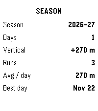
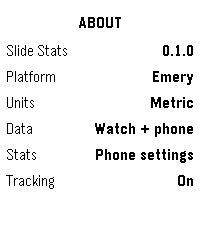
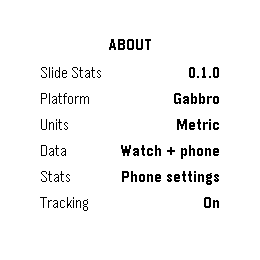
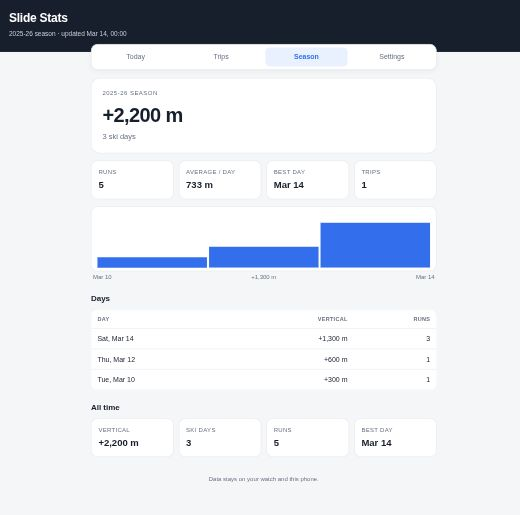

# Slide Stats

A Pebble watchapp that counts ski runs and vertical gained during a day on the mountain.

The watch face is deliberately plain: a large clock, the day's run and vertical totals,
and nothing else unless something needs attention. In the background the app watches
altitude, recognises ski-lift rides automatically, and stores each completed lift.
Completed lifts sync to the phone, where a fully local dashboard shows day, trip, and
season statistics.

Built with [Alloy](https://developer.repebble.com/guides/alloy/), the Pebble JavaScript
framework, and drawn with Poco for a small memory footprint and infrequent redraws.

## Platform support

Alloy runs only on **Emery (Pebble Time 2)** and **Gabbro (Pebble Round 2)**. Those are
the only targets in `package.json`.

There is no barometer on either watch, so altitude comes from the phone's GPS. The watch
app has to stay open while skiing, and the phone has to stay connected with location
permission granted.

## Status

A working first version:

- Automatic lift detection (fast and slow tiers, median-filtered altitude, descent-based
  ending)
- Auto-start on launch, pause, end day, undo last lift
- Time at the true centre of the display, with runs and vertical directly below
- Icon-only status: pause and no-GPS, and only when they need attention
- Native-style scrolling More menu that follows the watch's Text Size setting
- North/South seasons, re-bucketed automatically if the setting changes
- One-blob persistence with a sync outbox that drains on launch
- Lift sync to PebbleKit JS, deduped on the phone
- Local dashboard: Today, Trips, Season, Settings, with live metric/imperial conversion
  for units and lift-detection thresholds
- Metric by default

Not done yet: real-world threshold tuning, accelerometer-gated GPS, and backcountry mode
(issue #1).

## Screens

### Emery (Pebble Time 2)

| Main | Today | Season |
| --- | --- | --- |
|  |  |  |

| More | About |
| --- | --- |
|  |  |

### Gabbro (Pebble Round 2)

| Main | Today | Season |
| --- | --- | --- |
|  |  |  |

| More | About |
| --- | --- |
|  |  |

### Phone dashboard



## Build

PebbleKit JS is bundled with webpack, which needs Node on `PATH`. Install the one runtime
dependency first:

```sh
npm install
```

Then build and run:

```sh
pebble build
pebble install --emulator emery
pebble install --emulator gabbro
pebble logs --emulator emery
```

A watchapp does not auto-launch on a fresh emulator. Press Select to open the launcher,
then Select again.

## Tests

The detector, season/trip maths, day store, and formatting live in
`src/embeddedjs/lib/core.js`; phone-side aggregation is in `src/pkjs/lib/stats.js`.
There are 50 tests. Run them with Node 22 or newer:

```sh
node --test test/*.test.mjs
```

## Debug mock

While `DEBUG` is true at the top of `src/embeddedjs/main.js`, the More menu ends with
**Debug: Mock Lift**. It feeds a synthetic 100 m climb and descent through the same
detector, day store, UI, and sync path, which is how the app is tested in the emulator
(the emulator's fake GPS has no altitude). Remove the flag before publishing.

## How the data moves

- The **watch** owns today: today's lifts, per-day aggregates, and an outbox of
  unacknowledged records. Everything is one `localStorage` blob. A day starts when the
  app opens; there is no base altitude to set.
- After each completed lift the watch sends one `Sync` message. The phone stores it under
  `date + seq`, so a retry cannot duplicate a lift, and replies with an `Ack`.
- The **phone** owns history. Lift records live in PebbleKit JS `localStorage`, which
  survives app restarts and upgrades.
- The phone builds the stats page locally as a `data:` URL and opens it from the Pebble
  mobile app's settings gear. No server, no account, no network.

## Known limitations

- The app must stay open while skiing. Wakeups cannot track continuously.
- Closing the app mid-lift loses that in-progress lift; completed lifts survive.
- A lift that ends after local midnight counts on the new day.
- There is no current-altitude display and no base-altitude value; only run counts and
  vertical gain are shown.
- The dashboard requires the watch app to be running, because that is when PebbleKit JS
  is alive. The mobile app launches the watch app when the settings gear is tapped.
- The phone must keep feeding GPS while the watch app is open. Background-location
  behaviour on iOS is the first thing to verify on snow.
- The GPS stream stays open for the session; the settings interval controls how often the
  watch evaluates altitude, not whether the phone's GPS radio is on.

## Roadmap

- Field-test and tune detection against real chairlift traces
- Accelerometer-gated GPS for battery
- Backcountry mode (issue #1)
