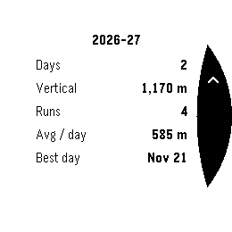

# Slide Stats

A Pebble watchapp that counts ski runs and vertical gained during a day on the mountain.

The watch face is deliberately plain: a large clock, the day's run and vertical totals,
and nothing else unless something needs attention. In the background the app watches
altitude, recognises ski-lift rides automatically, and stores each completed lift.
Completed lifts sync to the phone, where a fully local dashboard shows day, trip, and
season statistics.

Built with [Alloy](https://developer.repebble.com/guides/alloy/), the Pebble JavaScript
framework, and drawn with Poco for a small memory footprint and infrequent redraws.

## Platform support

Alloy runs only on **Emery (Pebble Time 2)** and **Gabbro (Pebble Round 2)**. Those are
the only targets in `package.json`.

There is no barometer on either watch, so altitude comes from the phone's GPS. The watch
app has to stay open while skiing, and the phone has to stay connected with location
permission granted.

## Status

A working first version:

- Automatic lift detection (fast and slow tiers, median-filtered altitude, descent-based
  ending)
- Auto-start on launch, pause, end day, undo last lift
- Time at the true vertical centre — centred in the content area on Emery and in the circle on Gabbro — with runs and vertical directly below
- Native action bar on the right: straight on Emery, curved on Gabbro, with
  destination icons for Up/Select/Down
- Phone-backed Today and Season history: Up/Down walk older and newer days or seasons,
  while today's numbers stay live on the watch
- Icon-only status: pause and no-GPS, and only when they need attention
- Native-style scrolling More menu with no header, bold text, and a black left bar for the
  selected row; fonts follow the watch's Text Size setting up to an 18 px cap
- Two-peak mountain app icon with a snow cap
- North/South seasons, re-bucketed automatically if the setting changes
- One-blob persistence with a sync outbox that drains on launch
- Lift sync to PebbleKit JS with unique record ids, so reinstalls, seq resets, and a
  second watch cannot double-count
- Local dashboard: Today, Trips, Season, Settings, with live metric/imperial conversion
  for units and lift-detection thresholds
- Metric by default

Not done yet: real-world threshold tuning, accelerometer-gated GPS, backcountry mode
(issue #1), and bar/text colour presets (issue #2).

## Using it

- **Main:** Up opens Season, Down opens Today, Select opens More, Back exits.
- **Today / Season:** Up and Down move to older and newer days or seasons; the action bar
  shows plain chevrons only in the directions that exist. Select does nothing and Back
  returns to Main.
- Day titles are **TODAY**, **YESTERDAY**, or **MMM DD**; season titles are the season
  label, such as **2026–27**. Vertical values are unsigned.
- Today's totals are read live from the watch. Past days and all seasons come from the
  phone, which keeps the full history and answers one summary at a time. The watch
  prefetches only the selected summary's immediate neighbours.

## Screens

### Emery (Pebble Time 2)

| Main | Today | Season |
| --- | --- | --- |
|  |  |  |

| More |
| --- |
|  |

### Gabbro (Pebble Round 2)

| Main | Today | Season |
| --- | --- | --- |
|  |  |  |

| More |
| --- |
|  |

### App icon


The launcher icon is `resources/images/menu_icon.png` (25×25, the Pebble tool's menu-icon
cap); 80×80 and 144×144 store copies are in `store/`. All are generated by
`tools/make-icons.py` and can be regenerated with Pillow installed.

### Phone dashboard


## Build

PebbleKit JS is bundled with webpack, which needs Node on `PATH`. Install the one runtime
dependency first:

```sh
npm install
```

Then build and run:

```sh
pebble build
pebble install --emulator emery
pebble install --emulator gabbro
pebble logs --emulator emery
```

A watchapp does not auto-launch on a fresh emulator. Press Select to open the launcher,
then Select again.

## Tests

The detector, season keys, day store, and formatting live in
`src/embeddedjs/lib/core.js`; phone-side aggregation, trip maths, and summaries are in
`src/pkjs/lib/stats.js`.
There are 49 tests, including the phone sync/query handlers. Run them with Node 22 or
newer:

```sh
node --test test/*.test.mjs
```

## Testing in the emulator

The emulator's fake GPS reports no altitude, so lift detection cannot be exercised there.
The detector, store, phone summaries, and message handlers are covered by the Node tests;
real detection needs a watch and phone outdoors. The temporary mock-lift menu item was
removed to keep the app bundle inside the watch's archive mapping limit.

## How the data moves

- The **watch** owns today: today's lifts and an outbox of unacknowledged records.
  Everything is one `localStorage` blob. A day starts when the app opens; there is no base
  altitude to set.
- After each completed lift the watch sends one `Sync` message. Every record carries a
  unique `uid`; the phone dedupes by `uid` (falling back to `seq` for older records) and
  replies with an `Ack`. A retry cannot duplicate a lift, and two watches can share one
  combined history without per-watch totals.
- The **phone** owns history. Lift records live in PebbleKit JS `localStorage`, which
  survives app restarts and upgrades.
- The watch asks for one day or season summary at a time with `Query`; the phone answers
  with `Data`. Today's totals stay local; the phone supplies past-day totals and the
  neighbouring keys. The watch caches only a handful of summaries and prefetches one level.
- The phone builds the stats page locally as a `data:` URL and opens it from the Pebble
  mobile app's settings gear. No server, no account, no network.

## Known limitations

- The app must stay open while skiing. Wakeups cannot track continuously.
- Closing the app mid-lift loses that in-progress lift; completed lifts survive.
- A lift that ends after local midnight counts on the new day.
- There is no current-altitude display and no base-altitude value; only run counts and
  vertical gain are shown.
- The dashboard requires the watch app to be running, because that is when PebbleKit JS
  is alive. The mobile app launches the watch app when the settings gear is tapped.
- The phone must keep feeding GPS while the watch app is open. Background-location
  behaviour on iOS is the first thing to verify on snow.
- The GPS stream stays open for the session; the settings interval controls how often the
  watch evaluates altitude, not whether the phone's GPS radio is on.

## Roadmap

- Field-test and tune detection against real chairlift traces
- Accelerometer-gated GPS for battery
- Backcountry mode (issue #1)
